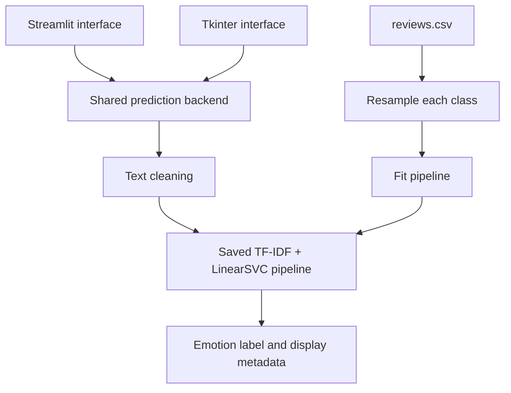

# Movie Emotion Classifier

A Python application that assigns one of four emotion labels—**happy, sad, angry, or neutral**—to a movie review. It is a learning project for students exploring text classification and for anyone who wants to try a local review-classification demo.

**Stack:** Python · scikit-learn · pandas · Streamlit · Tkinter

## Try it

The repository includes a **Streamlit web interface** and a **Tkinter desktop interface**, both using the same prediction backend. A hosted demo URL has not been verified; use the local setup below.

1. Enter a movie review.
2. Select **Predict** in Streamlit or **Detect Emotion** on desktop.
3. Read the predicted label and its short description.

The desktop application also includes example reviews and a Ctrl+Enter shortcut.

## Architecture



Training and inference are separate scripts. The backend loads the saved model when imported, cleans input text, runs prediction, and maps the resulting label to display metadata.

## Technical decisions and trade-offs

| Challenge | Current implementation | Trade-off |
| --- | --- | --- |
| Convert text into model features | TF-IDF followed by LinearSVC in a scikit-learn pipeline | A relatively simple text-classification baseline; limited handling of context, sarcasm, and mixed emotions. |
| Handle class imbalance | Resample each label to 10,000 rows with replacement and a fixed sampling seed | Equal class sizes, but duplicated rows do not add new information. |
| Support two interfaces | Streamlit and Tkinter reuse `backend.predict` | Avoids duplicated inference logic; inference is synchronous and runs in the interface process. |
| Keep training features with the classifier | Save the fitted pipeline as `emotion_model.pkl` | Simplifies inference, but pickle artifacts depend on compatible Python/package environments. |
| Present results clearly | Map each label to an emoji, colour, and description | Gives one label without a calibrated confidence score. |

## Run locally

Install Python 3 and Git. Run the following commands from a terminal:

```bash
git clone https://github.com/vedant-dethe/movie-emotion-classifier.git
cd movie-emotion-classifier
python -m venv .venv
```

Activate the environment:

**Windows PowerShell**

```powershell
.\.venv\Scripts\Activate.ps1
```

**macOS / Linux**

```bash
source .venv/bin/activate
```

Install dependencies:

```bash
python -m pip install -r requirements.txt
```

Start the web interface:

```bash
python -m streamlit run app.py
```

Or start the desktop interface:

```bash
python movie_emotion_classifier.py
```

The desktop interface requires Tkinter and a graphical display. Some Linux Python installations require Tkinter to be installed separately.

Run commands from the repository root: the scripts use relative paths for the dataset and model. Dependencies are currently unpinned, so exact environment reproduction is not yet guaranteed. Only load pickle model files from sources you trust.

## Training

The dataset must contain `review` and `emotion` columns. The UI expects the labels `happy`, `sad`, `angry`, and `neutral`.

```bash
python train_balanced_model.py
```

This resamples each class to 10,000 rows, fits a TF-IDF + LinearSVC pipeline, and **overwrites `emotion_model.pkl`**. The current training script does not create a held-out test split.

## Evaluation and known limitations

```bash
python model_analysis.py
```

The analysis script prints accuracy, a confusion matrix, a classification report, and sample predictions.

**These are diagnostic results, not an independent test benchmark.** Training resamples from `reviews.csv`, and analysis evaluates on that same source dataset. Their overlap can inflate performance estimates. The previously documented approximately 76% accuracy is therefore not presented here as evidence of generalisation.

Other limitations visible in the current code:

- Training and analysis use raw reviews, while the prediction backend applies additional text cleaning.
- Dataset provenance, annotation method, and reuse permissions are not documented.
- The current source tree has no automated tests or CI workflow.
- Model-loading errors and unexpected labels are not handled by the backend.
- Package versions and a reproducible environment are not recorded.

## Repository guide

| File | Purpose |
| --- | --- |
| `app.py` | Streamlit interface |
| `movie_emotion_classifier.py` | Tkinter interface and example inputs |
| `backend.py` | Model loading, text cleaning, prediction, and label metadata |
| `train_balanced_model.py` | Class resampling, pipeline training, and model export |
| `model_analysis.py` | Dataset diagnostics and sample predictions |
| `reviews.csv` | Source review text and emotion labels |
| `emotion_model.pkl` | Saved model loaded by the backend |
| `tfidf_vectorizer.pkl` | Separate artifact; not loaded by the current backend |
| `requirements.txt` | Python dependencies |

## Next engineering milestones

These are planned improvements, not implemented features.

- Split and deduplicate the data before resampling; resample only the training partition.
- Share preprocessing between training and inference.
- Compare against a simple baseline and report held-out macro-F1, per-class precision/recall, and a confusion matrix.
- Add tests for text cleaning, blank input, label mapping, and model loading.
- Pin dependency versions and add CI.
- Document dataset provenance and add a screenshot or verified hosted demo.

## Author

[Vedant Dethe](https://github.com/vedant-dethe)
